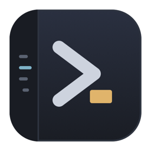
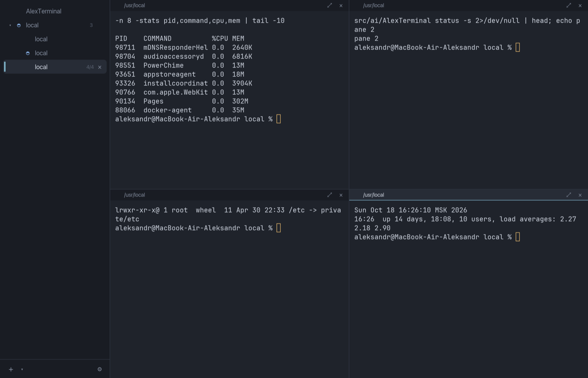
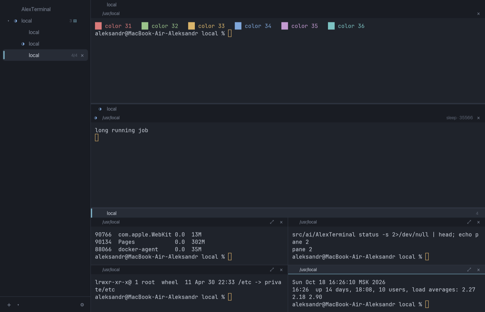
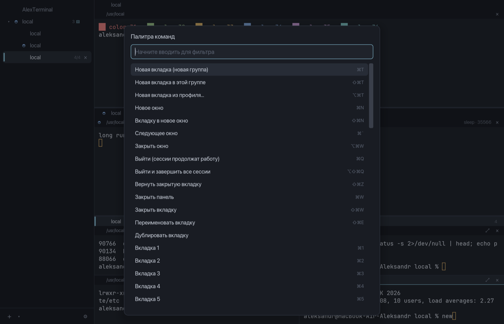

<p align="center">
  
</p>

<h1 align="center">AlexTerminal</h1>

<p align="center">
  Терминал для macOS и Linux на Rust: вкладки списком слева, группы вкладок,<br>
  до четырёх панелей во вкладке и сессии, которые переживают закрытие окна.
</p>

<p align="center">
  
</p>

## Возможности

- **Вкладки слева.** Вкладки идут вертикальным списком. Верхний уровень — группы, внутри групп — вкладки-терминалы. Группа из одной вкладки показывается одной строкой.
- **Группа целиком в одном окне.** Вкладки группы можно смотреть по одной или все сразу, секциями друг под другом (`⌘⇧G`). Высоту секций меняют перетаскиванием границы.
- **До четырёх панелей во вкладке.** Панели стоят вертикальным стеком. Четыре панели переключаются в сетку 2×2 (`⌘⇧M`), размеры меняются мышью и с клавиатуры.
- **Сессии не умирают вместе с окном.** Shell-процессы живут в фоновом сервере `alexterminal-server`. Закрытие окна и выход из приложения не прерывают ssh, сборки и редакторы, следующий запуск подключается к ним.
- **Восстановление после перезагрузки.** Окна, группы, вкладки, папки и последние строки вывода сохраняются в слепок. Удалённые сессии после перезапуска предлагается переподключить.
- **История команд у каждой панели.** Каждая панель пишет свою историю в файл с папкой и кодом выхода. Стрелка вверх в shell тоже показывает только команды этой панели.
- **Индикаторы на вкладках.** Видно, где выполняется команда, где открыт ssh и где команда завершилась в фоне.
- **Shell-интеграция для zsh, bash и fish.** Она подключается автоматически и сообщает терминалу текущую папку, начало и конец команды и хост ssh.
- **Открыть папку.** `⌘⇧O` открывает текущую папку панели в Finder или файловом менеджере, `⌘⇧I` — в редакторе.
- **Палитра команд** (`⌘⇧P`) с поиском по всем действиям. Поиск по прокрутке, распознавание ссылок по `⌘`-клику, профили вкладок.
- **Спокойные цвета.** Тёмная тема Dusk и светлая Linen подобраны под умеренный контраст. Шрифт JetBrains Mono, можно импортировать темы Alacritty.
- **Интерфейс на русском и английском**, язык берётся из системы.

<p align="center">
  
  
</p>

## Сборка из исходников

Сборка и запуск проверены на macOS 26 (Apple Silicon) с Rust 1.99. Для Linux список системных пакетов взят из требований iced и winit, на живой системе сборка ещё не проверялась.

### 1. Подготовка macOS

1. Установите инструменты командной строки Xcode, если их ещё нет:

   ```bash
   xcode-select --install
   ```

2. Установите Rust через rustup. Подойдёт официальный установщик с [rustup.rs](https://rustup.rs) или Homebrew:

   ```bash
   brew install rustup
   ```

   ```bash
   rustup default stable
   ```

   Homebrew ставит `rustup` без ссылок в `PATH`. Добавьте его в `~/.zshrc`:

   ```bash
   echo 'export PATH="/opt/homebrew/opt/rustup/bin:$HOME/.cargo/bin:$PATH"' >> ~/.zshrc
   ```

3. Проверьте версию. Нужен Rust 1.85 или новее:

   ```bash
   cargo --version
   ```

### 1. Подготовка Linux

1. Установите компилятор и библиотеки окна, клавиатуры и графики.

   Debian и Ubuntu:

   ```bash
   sudo apt install build-essential pkg-config curl git libxkbcommon-dev libwayland-dev libx11-dev libxcursor-dev libxrandr-dev libxi-dev libvulkan-dev
   ```

   Fedora:

   ```bash
   sudo dnf install gcc pkgconf-pkg-config curl git libxkbcommon-devel wayland-devel libX11-devel libXcursor-devel libXrandr-devel libXi-devel vulkan-loader-devel
   ```

   Arch:

   ```bash
   sudo pacman -S base-devel curl git libxkbcommon wayland libx11 libxcursor libxrandr libxi vulkan-icd-loader
   ```

2. Установите Rust:

   ```bash
   curl --proto '=https' --tlsv1.2 -sSf https://sh.rustup.rs | sh
   ```

### 2. Получение кода и шрифта

```bash
git clone <адрес-репозитория> AlexTerminal
```

```bash
cd AlexTerminal
```

Шрифт JetBrains Mono (лицензия OFL) в репозитории не хранится. Скрипт скачивает его в `assets/fonts`:

```bash
scripts/fetch-fonts.sh
```

Шаг необязательный. Без шрифта приложение возьмёт SF Mono, Menlo или DejaVu Sans Mono.

### 3. Сборка и запуск

Отладочный запуск прямо из исходников:

```bash
cargo run --bin alexterminal
```

Release-сборка. Первая сборка скачивает зависимости и занимает несколько минут:

```bash
cargo build --release
```

```bash
./target/release/alexterminal
```

Получаются два бинарника, и они должны лежать рядом:

| Файл | Назначение |
|---|---|
| `alexterminal` | Окна и интерфейс, при запуске сам поднимает сервер |
| `alexterminal-server` | Фоновый сервер сессий, владеет всеми shell-процессами |

### 4. Установка

**macOS.** Скрипт собирает `dist/AlexTerminal.app` и образ `dist/AlexTerminal-<версия>.dmg`:

```bash
packaging/macos/build-app.sh
```

Затем перетащите `AlexTerminal.app` в «Программы» или скопируйте командой:

```bash
cp -R dist/AlexTerminal.app /Applications/
```

Без подписи Developer ID macOS при первом запуске предупредит о неизвестном разработчике. Откройте приложение через контекстное меню «Открыть» или подпишите сборку по шагу 6.

**Linux.** Скрипт собирает `.deb` через cargo-deb и AppImage, если установлен `linuxdeploy`:

```bash
packaging/linux/build.sh
```

Ручная установка в домашний каталог без пакетов:

```bash
install -Dm755 target/release/alexterminal target/release/alexterminal-server -t ~/.local/bin/
```

```bash
install -Dm644 packaging/linux/alexterminal.desktop -t ~/.local/share/applications/
```

```bash
install -Dm644 assets/icon-256.png ~/.local/share/icons/hicolor/256x256/apps/alexterminal.png
```

### 5. Тесты и проверки

```bash
cargo test --workspace
```

```bash
cargo clippy --workspace --all-targets -- -D warnings
```

```bash
cargo fmt --all --check
```

Тесты запускают настоящие shell-процессы в PTY и сервер сессий в изолированном каталоге. Ваши настройки и сессии они не трогают. Эти же проверки выполняет GitHub Actions на macOS и Ubuntu, см. `.github/workflows/ci.yml`.

### 6. Подпись, нотаризация и универсальный бинарник (macOS)

Скрипт упаковки управляется переменными окружения:

| Переменная | Что делает |
|---|---|
| `UNIVERSAL=1` | Собирает arm64 и x86_64 и объединяет их через `lipo` |
| `SIGN_IDENTITY` | Подписывает бинарники, `.app` и `.dmg` с hardened runtime |
| `NOTARY_PROFILE` | Отправляет `.dmg` на нотаризацию и прикрепляет тикет |

Профиль нотаризации создаётся один раз:

```bash
xcrun notarytool store-credentials alexterminal-notary --apple-id you@example.com --team-id TEAMID
```

Полная сборка релиза:

```bash
UNIVERSAL=1 SIGN_IDENTITY="Developer ID Application: Имя (TEAMID)" NOTARY_PROFILE=alexterminal-notary packaging/macos/build-app.sh
```

Для релиза по тегу `v*` CI делает то же самое. Ему нужны секреты `MACOS_CERT_P12`, `MACOS_CERT_PASSWORD`, `MACOS_SIGN_IDENTITY`, `NOTARY_API_KEY_P8`, `NOTARY_API_KEY_ID` и `NOTARY_API_ISSUER`.

## Основные сочетания клавиш

На Linux вместо `⌘` используется `Ctrl+Shift`. Полный список с поиском открывается палитрой команд, все сочетания переназначаются в настройках.

| Действие | macOS |
|---|---|
| Новая вкладка (новая группа) | `⌘T` |
| Новая вкладка в текущей группе | `⌘⇧T` |
| Вкладки группы вместе или по одной | `⌘⇧G` |
| Новая панель | `⌘D` |
| Стек ↔ сетка 2×2 | `⌘⇧M` |
| Переход между панелями | `⌘⌥←↑↓→` |
| Закрыть панель / вкладку | `⌘W` / `⌘⇧W` |
| Вернуть закрытую вкладку | `⌘⇧Z` |
| Вкладка 1…9 | `⌘1…9` |
| Открыть папку в Finder | `⌘⇧O` |
| История команд панели | `⌘⇧H` |
| Поиск | `⌘F` |
| Палитра команд | `⌘⇧P` |
| Настройки | `⌘,` |
| Выйти, сессии продолжат работу | `⌘Q` |
| Выйти и завершить все сессии | `⌘⌥⇧Q` |

## Настройки и файлы

| Что | macOS | Linux |
|---|---|---|
| Настройки | `~/.config/alexterminal/config.toml` | `~/.config/alexterminal/config.toml` |
| Слепок, история, прокрутка | `~/Library/Application Support/AlexTerminal/` | `~/.local/share/alexterminal/` |
| Логи | `~/Library/Logs/AlexTerminal/` | `~/.local/state/alexterminal/` |

Окно настроек (`⌘,`) пишет тот же `config.toml`, изменения в файле подхватываются на лету. Все параметры с описанием перечислены в [SPEC.md](SPEC.md), раздел 5.

## Командная строка

```bash
alexterminal --working-directory ~/src/project
```

```bash
alexterminal --profile prod
```

```bash
alexterminal list
```

```bash
alexterminal-server --status
```

```bash
alexterminal-server --shutdown
```

Если окно уже открыто, `alexterminal` с аргументами добавляет вкладку в него, а не запускает второе приложение. `--no-daemon` запускает сервер внутри процесса окна: удобно для отладки, но сессии тогда завершаются вместе с окном.

## Решение проблем

- **После обновления.** Новая версия сама находит старый сервер сессий, просит его сохранить сессию и заменяет новым. Shell-процессы при этом перезапускаются в тех же папках.
- **Сервер не отвечает.** Остановите его вручную и откройте приложение снова:

  ```bash
  alexterminal-server --shutdown
  ```

- **Второй независимый экземпляр.** Переменная `ALEXTERMINAL_HOME` переносит настройки, данные, логи и сокет в отдельный каталог:

  ```bash
  ALEXTERMINAL_HOME=/tmp/at-test alexterminal
  ```

- **Подробные логи.** Уровень логов задаётся переменной окружения:

  ```bash
  ALEXTERMINAL_LOG=debug alexterminal
  ```

## Известные ограничения

- Нативного меню macOS пока нет. Все действия доступны через палитру команд, горячие клавиши и контекстное меню вкладки.
- Закрытие последнего окна завершает приложение и на macOS. Сессии при этом остаются в сервере и откроются при следующем запуске.
- Папка в заголовке панели обновляется при показе приглашения shell. Если в одной строке выполнить `cd` и долгую команду, папка сменится после её завершения.
- После аварийного завершения сервера восстанавливается структура и папки, а вывод — только до последнего автосохранения (по умолчанию раз в 30 секунд).

## Устройство проекта

| Крейт | Назначение |
|---|---|
| `at-core` | Модель окон, групп и вкладок, конфиг, темы, горячие клавиши, история, слепок |
| `at-proto` | Протокол между окном и сервером: MessagePack с префиксом длины |
| `at-term` | Панель: PTY, эмулятор `alacritty_terminal`, shell-интеграция, кодирование ввода, данные о процессах |
| `at-daemon` | Сервер сессий `alexterminal-server` |
| `at-client` | Подключение к серверу, его автозапуск и замена устаревшей версии |
| `at-app` | Интерфейс на iced 0.14 и бинарник `alexterminal` |

Скрипты shell-интеграции лежат в `assets/shell/`, переводы — в `locales/en` и `locales/ru`. Техническое задание и принятые решения описаны в [SPEC.md](SPEC.md).

## Лицензия

MIT или Apache-2.0 на ваш выбор, как указано в `Cargo.toml`. Шрифт JetBrains Mono распространяется по SIL Open Font License 1.1.
